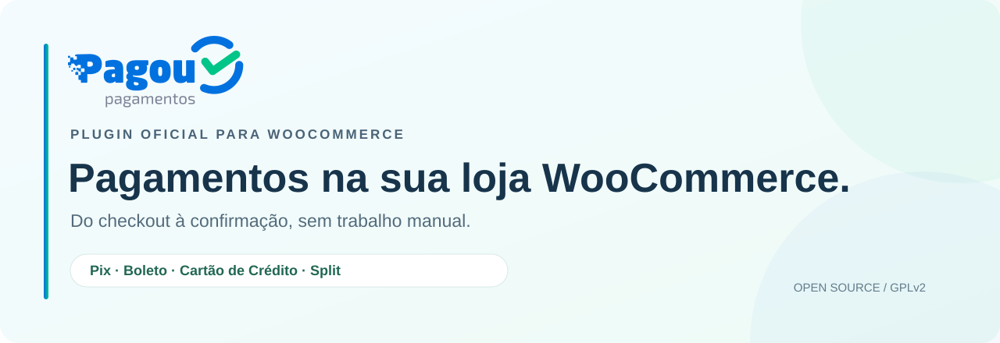

  

  <strong>Pagamentos integrados. Confirmação automática. Código aberto.</strong> 
  O plugin oficial da Pagou para receber na sua loja WooCommerce.

  
  
  
  
  
  
  

  <a href="https://wordpress.org/plugins/pagou-payments-for-woocommerce/"><strong>Instalar pelo WordPress.org</strong></a>
  &nbsp;·&nbsp;
  <a href="https://github.com/pagou-com-br/woocommerce/releases/download/v2.0.1/pagou-payments-for-woocommerce-2.0.1.zip"><strong>Baixar o plugin (.zip)</strong></a>
  &nbsp;·&nbsp;
  <a href="https://github.com/pagou-com-br/woocommerce/releases/tag/v2.0.1">Release notes</a>
  &nbsp;·&nbsp;
  <a href="https://github.com/pagou-com-br/woocommerce/releases/download/v2.0.1/SHA256SUMS">Checksum SHA-256</a>

  <a href="#requisitos">Requisitos</a> ·
  <a href="#instalacao">Instalação</a> ·
  <a href="#configuracao">Configuração</a> ·
  <a href="#estrutura">Estrutura</a> ·
  <a href="#ganchos">Ganchos</a> ·
  <a href="#webhook">Webhook</a> ·
  <a href="#licenca">Licença</a>

Plugin oficial da [Pagou](https://pagou.com.br/) para WooCommerce: Pix, boleto e cartão de crédito, com parcelamento, cartão salvo e split de pagamento entre contas Pagou.

## Requisitos

- WordPress 6.6 ou superior, PHP 7.4 ou superior
- WooCommerce 9.0 ou superior
- Conta Pagou com chave de API (cartão e split precisam ser habilitados pela Pagou)

## Instalação

- **Pelo WordPress (recomendado):** em **Plugins > Adicionar novo**, busque **Pagou** e clique em **Instalar agora**. As atualizações chegam pelo próprio painel.
- **Pelo .zip:** [baixe o plugin](https://github.com/pagou-com-br/woocommerce/releases/download/v2.0.1/pagou-payments-for-woocommerce-2.0.1.zip) e envie em **Plugins > Adicionar novo > Enviar plugin**. É o mesmo pacote publicado no WordPress.org.

## Configuração

1. Ative o plugin.
2. Em **WooCommerce > Configurações > Pagou**, escolha o ambiente (produção ou sandbox), informe a chave de API e clique em **Testar conexão**. A chave também pode ser definida pela constante `PAGOU_API_KEY` no `wp-config.php`.
3. Ative Pix, boleto e cartão em **WooCommerce > Configurações > Pagamentos**.
4. Opcional: configure o split na mesma aba da Pagou e, por produto, na aba **Split Pagou**.

## Estrutura

- `includes/classes/`: código PSR-4 no namespace `Pagou\WooCommerce` (gateways, API, webhook, conciliação, split, checkout em blocos).
- `templates/`: telas de pagamento, que o tema pode sobrescrever em `woocommerce/pagou/`.
- `assets/`: scripts do checkout, tokenização do cartão e estilos.

## Ganchos

- `pagou_wc_corpo_cobranca` (filtro): altera o corpo enviado à Pagou ao criar uma cobrança.
- `pagou_wc_split_recusado` (ação): disparada quando a Pagou recusa o split de uma cobrança.
- `pagou_wc_campos_configuracao` (filtro): acrescenta seções à aba de configurações.

## Webhook

As notificações chegam em `/wp-json/pagou/v1/webhook` (ou `?rest_route=/pagou/v1/webhook` sem permalinks amigáveis), assinadas com HMAC-SHA256. A URL é enviada em cada cobrança; não é preciso cadastrá-la no painel da Pagou.

## Licença

GPLv2 ou posterior.
